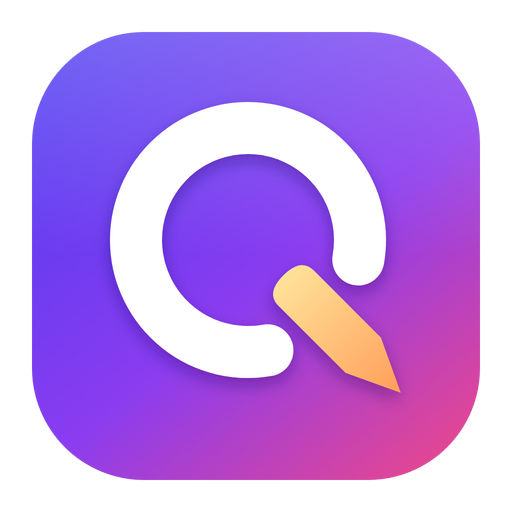
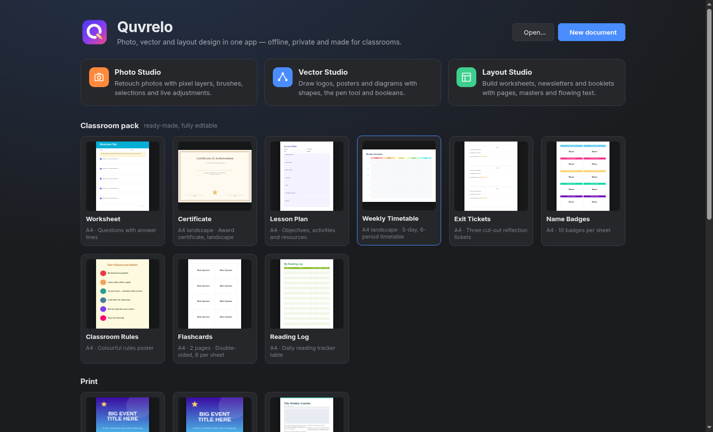
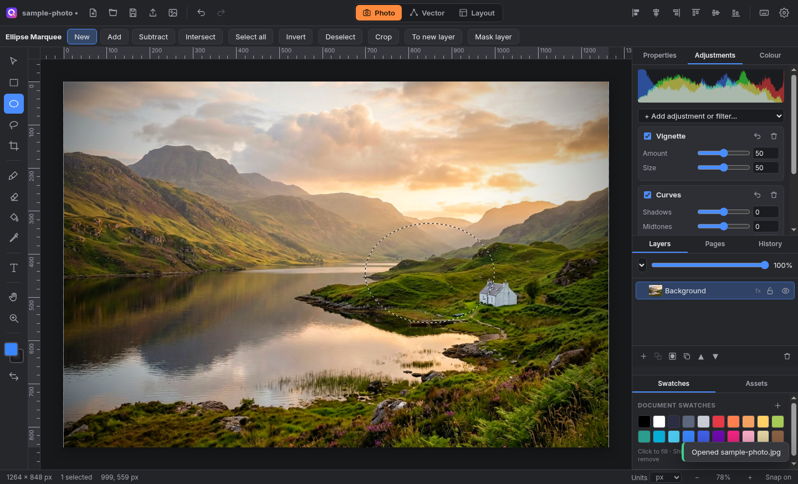
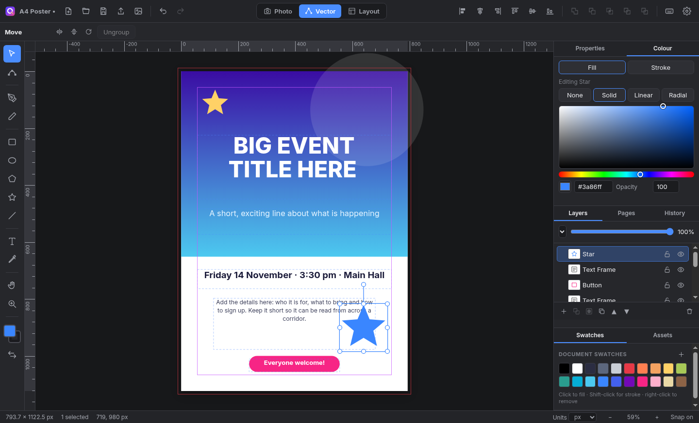
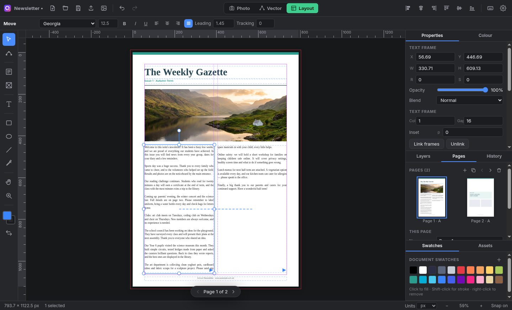

<p align="center"></p>

<h1 align="center">Quvrelo</h1>

<p align="center"><b>Photo editing, vector design and page layout in one app — built for schools and professional teams.</b><br>
Offline. No accounts. No telemetry. Free and open source (MIT). Windows and macOS.</p>

<p align="center">
  <a href="https://github.com/TheWarrior-tech/Quvrelo/releases/latest"><b>⬇ Download the latest release</b></a> ·
  <a href="docs/USER_GUIDE.md">User guide</a> ·
  <a href="docs/ADMIN_GUIDE.md">IT admin guide</a> ·
  <a href="CONTRIBUTING.md">Contributing</a>
</p>



Quvrelo is an all-in-one creative suite in the spirit of Affinity's single-app studios: one document, three **studios** you can switch between at any moment.

| Photo studio | Vector studio | Layout studio |
|---|---|---|
|  |  |  |

## Why Quvrelo

- **One app, one file.** Retouch a photo, draw a logo over it and lay it out in a multi-page newsletter without exporting between programs. Everything lives in a single `.quvrelo` file (a zip with your photos embedded).
- **Made for classrooms.** A ready-made classroom pack (worksheets, certificates, lesson plans, timetables, exit tickets, name badges, flashcards, reading logs, rules posters), a built-in assignment brief and **Hand In** workflow, dyslexia-friendly fonts, high-contrast mode and a scalable interface.
- **Made for IT teams.** Silent per-machine installers (NSIS `/S`, MSI `/qn`, macOS `.pkg`), a machine-wide `policy.json` to lock save locations, hide features, set themes and point at network template/hand-in folders. No sign-in, no licence server, no network traffic.
- **Private by design.** The renderer is blocked from making any network request. The only optional network call is the manual *Help ▸ Check for Updates*, which admins can disable.

## Features (v0.1)

### Shared across studios
- Dark, light and high-contrast themes; interface scaling 75–200%; dyslexia-friendly UI font; reduce-motion option
- Welcome screen with 17 templates, recent files and crash-recovery restore
- Rulers (px, mm, cm, in, pt), drag-out guides, margin/column/bleed guides, smart snapping to page, margins, guides and other objects
- Zoom to cursor, pan with Space/middle mouse/trackpad, zoom to fit/100%
- Layers panel (reorder by drag, rename, lock, hide, opacity, blend modes, masks), Properties inspector, Colour panel with HSV picker and gradients, Swatches, Assets (shape library + placed images), History panel (click any step)
- Full undo/redo (structural-sharing snapshots — cheap even for photos), autosave + crash recovery
- Native menus and keyboard shortcuts for everything, cheat sheet on <kbd>F1</kbd>
- Export PNG, JPEG, SVG (true vectors and text) and multi-page PDF with bleed, crop marks, trim/bleed boxes

### Photo studio
- Open PNG, JPEG, WebP, GIF, BMP; paste images from the clipboard; drag and drop
- Pixel layers with brush and eraser (size, hardness, opacity), flood fill, colour picker
- Rectangle, ellipse and freehand selections with add / subtract / intersect, invert, fill, clear, copy to new layer, crop to selection, mask to selection
- **Non-destructive live adjustments:** Brightness/Contrast, Levels, Curves, Hue/Saturation, Exposure, Vibrance, White Balance, Black & White, Invert, Posterize, Threshold
- **Live filters:** Gaussian Blur, Unsharp Mask, Add Noise, Vignette — plus a live histogram; *Apply to pixels* bakes them in
- Crop tool with rule-of-thirds overlay, resize document/canvas, layer opacity and 16 blend modes, merge down, rasterise

### Vector studio
- Rectangle (rounded corners), ellipse, polygon, star, line, pen (bezier), pencil (smoothed freehand)
- Node tool: drag anchors and handles, toggle smooth/corner, delete nodes, convert any shape to curves
- Solid, linear and radial gradient fills; strokes with width, dash, caps and joins
- Boolean operations: add, subtract, intersect, exclude, divide
- Align, distribute, group/ungroup, flip, rotate, arrange; artistic text; SVG import (editable paths) and export

### Layout studio
- Multi-page documents, page panel with live thumbnails, reorder/duplicate/delete pages
- Master pages (headers, footers, backgrounds) applied per page
- Text frames with columns, inset, **linked frames with flowing text** and overflow indicator; justified text, leading, tracking
- Picture frames with fill / fit / stretch / original-size and content zoom & offset
- Margins, bleed, column guides; multi-page PDF export at 96/150/300 dpi

## Download & install

Get the installers from the [latest release](https://github.com/TheWarrior-tech/Quvrelo/releases/latest):

| Platform | File | Notes |
|---|---|---|
| Windows (x64 / ARM64) | `Quvrelo-Setup-<version>-x64.exe` / `-arm64.exe` | Choose *just me* or *all users* |
| Windows (managed) | `Quvrelo-<version>-x64.msi` / `-arm64.msi` | Per-machine, for Intune / SCCM / GPO |
| macOS (Apple silicon / Intel) | `Quvrelo-<version>-mac-arm64.dmg` / `-x64.dmg` | Drag to Applications |
| macOS (managed) | `Quvrelo-<version>-mac-arm64.pkg` / `-x64.pkg` | Installs to /Applications, for Jamf / MDM |
| Linux (any distro) | `Quvrelo-<version>-x86_64.AppImage` | `chmod +x`, then run |
| Linux (Debian / Ubuntu) | `Quvrelo-<version>-amd64.deb` | `sudo apt install ./Quvrelo-*.deb` |
| Linux (Fedora / RHEL / openSUSE) | `Quvrelo-<version>-x86_64.rpm` | `sudo dnf install ./Quvrelo-*.rpm` |

### Windows SmartScreen
The installers are not yet code-signed, so Windows may show *"Windows protected your PC"*. Click **More info ▸ Run anyway**. Managed deployments via MSI/Intune are not affected by SmartScreen prompts.

### macOS Gatekeeper
The app is not yet notarised by Apple. The first time you open it, **right-click (or Control-click) Quvrelo in Applications and choose Open**, then click **Open** in the dialog. On macOS 15+, if there is no Open button, go to **System Settings ▸ Privacy & Security** and click **Open Anyway**. IT admins can remove the quarantine flag after deployment:

```sh
sudo xattr -dr com.apple.quarantine "/Applications/Quvrelo.app"
```

## For IT administrators
See the [IT admin deployment guide](docs/ADMIN_GUIDE.md) for silent install switches, the `policy.json` reference and an example policy. Quick reference:

```bat
:: Windows, per-machine, silent
msiexec /i Quvrelo-0.1.0-x64.msi /qn
Quvrelo-Setup-0.1.0-x64.exe /S /allusers
```
```sh
# macOS, silent
sudo installer -pkg Quvrelo-0.1.0-mac-arm64.pkg -target /
```

## Building from source

Requires Node.js 22+.

```sh
npm ci
npm run dev          # run with hot reload
npm run typecheck
npm test             # unit tests (Vitest)
npm run build
npm run test:e2e     # Electron end-to-end tests (Playwright); on Linux use xvfb-run
npm run dist         # installers for the current OS into ./release
```

Architecture in one paragraph: `src/core` holds the pure, fully unit-tested document model shared by all studios (immutable document, commands, history, text flow, pixel operations, boolean ops, SVG exporter, `.quvrelo` serialisation, templates, policy). `src/renderer` is the React UI plus the canvas engine (a single scene renderer used for the editor, thumbnails and every export, with fabric.js providing selection and transform handles). `src/main` is the Electron shell (file IO, menus, policy, recovery). See [CONTRIBUTING.md](CONTRIBUTING.md).

## Roadmap
Quvrelo is under active development. Next up: vector (not rasterised) PDF and PDF/X, PSD/IDML import, per-character text styles and paragraph styles, layer effects (shadow, glow), magic wand, healing brush, spreads view, CMYK preview. Progress is tracked in the parity checklist in the project workspace and in GitHub issues.

## Licence
[MIT](LICENSE). Bundled fonts are under the SIL Open Font License.
